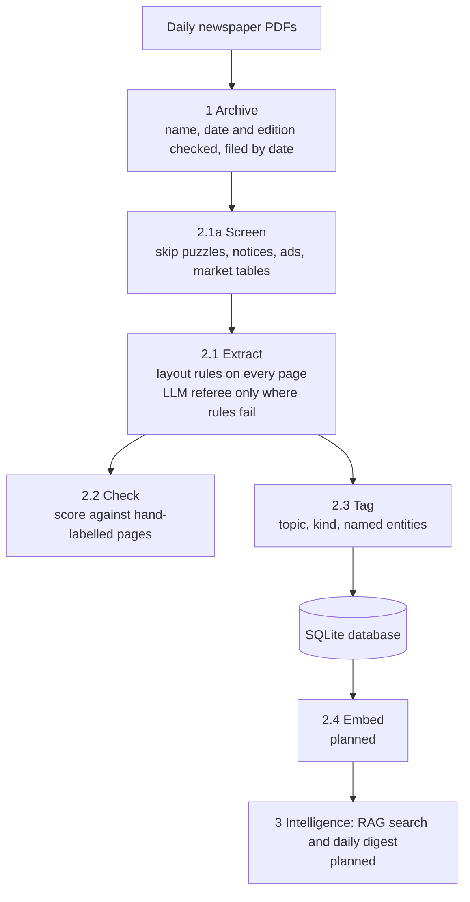

# News Intelligence

A personal pipeline that turns the daily PDF editions of Indian national newspapers into a structured,
searchable dataset of articles, so that themes can be followed and stories linked across papers and days.

Author: Kunaal Gautam · Started August 2026 · **Work in progress** (status of every part is in the table below)

---

## Why

A printed newspaper page is a layout, not a list of articles: columns, boxes, jumps to other pages, ads,
puzzles and market tables all sit together. Before anything useful can be asked of a month of newspapers
("how has coverage of the RBI changed?", "which companies appear across all five papers?"), each page has to be
split into clean, separate articles. That splitting step is most of the work in this repository, and it is
measured against hand-labelled pages rather than judged by eye.

## Pipeline



| Step | What it does | Method |
|---|---|---|
| **1 Archive** | Files each PDF as `archive/<date>/<date>_<Publisher>.pdf` | Publisher from a model answer cross-checked against an allow-list; date by majority vote of page text, model and filename (2 of 3 must agree) |
| **2.1a Screen** | Removes non-news pages and zones before splitting | Tiers: no text layer → skip; bordered box with a junk label → blank; box-heavy page → blank; each paper's printed labels (SUDOKU, TENDER NOTICE, STOCKS…) → skip page or blank the zone |
| **2.1 Extract** | Splits each page into articles; joins stories that continue on another page | Layout and typography rules (PyMuPDF) on every page; on papers where rules fail, an LLM referee regroups text blocks (forced tool use, validated, fail-closed, ~$0.01 per page, answers cached so nothing is paid twice); settings chosen per paper by A/B test |
| **2.2 Check** | Measures extraction quality | Coverage, pairwise precision and recall, stories kept intact, per paper, against hand-labelled answer keys |
| **2.3 Tag** | Labels each article | Topic (16-value controlled vocabulary), kind (news, opinion, brief, sponsored…), named entities with canonical names; results in SQLite |
| **2.4 Embed** | One vector per article | Planned: small local embedding model |
| **3 Intelligence** | Answers questions with citations; daily digest of recurring themes linked to earlier coverage | Planned: retrieval-augmented generation (RAG) and an agent with tools |

## How quality is measured

**Gold set:** 61 newspaper pages labelled by hand at text-block level: 39 practice pages used for tuning and
22 held-out pages, sealed until the final test.

**Metrics** (word-weighted):
- **Coverage**: share of real story text that ends up inside some article.
- **Pairwise precision**: of the text pieces the pipeline put in the same article, the share that really belong
  to the same story (low = different stories merged).
- **Pairwise recall**: of the text pieces that belong to the same story, the share the pipeline kept together
  (low = one story cut into pieces).
- **Stories intact**: stories reproduced exactly.

**Method:** every change is an A/B test on the practice pages with a decision rule fixed in advance; the
version is then frozen (git tag `exam-v1`) and run **once** on the held-out pages.

### Results

Practice pages (39), rules alone → full pipeline: coverage 97.0 → **97.6**, precision 95.3 → **96.4**,
recall 89.6 → **90.5**, stories intact 200 → **214 / 253**. Fake articles from junk pages: 19 → **3**.

Held-out test (22 pages, frozen version `exam-v1`, run once on 18 Oct 2026):

| Paper | Coverage | Precision | Recall | Result |
|---|---|---|---|---|
| Business Line | 97.4 | 97.6 | 95.1 | pass |
| The Hindu | 99.2 | 97.3 | 97.6 | pass |
| Business Standard | 97.3 | 96.0 | 92.0 | pass |
| Times of India | 98.2 | 82.5 | 88.0 | known limit: multi-story feature packages merged |
| Mint | 96.3 | 92.2 | 80.1 | known limit: long features split at subheadings |
| **All papers** | **97.7** | **89.4** | **89.3** | stories intact 124 / 155 |

Pass line: 90% on each metric. Papers that failed are recorded as known limits, not re-tuned against the
held-out pages; fixes are listed for the next version and will be tested on fresh held-out pages.

### Tagging baseline (v0)

A first, quick tagging pass to get baseline numbers (19 Oct 2026, Claude Haiku 5.5, `src/p2_tag.py`).
**It is a baseline, not the final tagging step:** the planned process (agreed topic list, a 60-article
evaluation with pass lines fixed in advance and a model comparison, then the full run) still follows.

It ran on the articles extracted before the freeze (Economic Times excluded); the database snapshot and
the code are tagged `tag-v0-baseline`.

| Measure | Result |
|---|---|
| Articles tagged | **5,551 of 5,578**; 27 answers rejected by validation (0.5%), retried on a re-run |
| Cost, full run | **$2.50** on the normal API (about $0.46 per 1,000 articles) |
| Topic accuracy (60-article hand audit) | **92%** (55/60); news articles only 96% (51/53) |
| Kind accuracy (same audit) | **98%** (59/60) |
| Unique entities (canonical name, case-insensitive) | **16,378**; 36,428 mentions (6.6 per article) |
| Entities named in 3+ different papers | **952** |
| Model's own text check | 59.6% ok · 29.8% fragment · 6.7% two stories · 3.9% garbled |

What these numbers do not show yet:
- **Entities are not audited.** Canonical names come from the model, so the same entity can appear under two
  names; merging them (entity resolution) is part of the full tagging step.
- **The text check is the model's opinion**, not a measurement. In the audit, extraction problems caused
  wrong tags in 2 of 60 articles (3.3%).
- Of the 5 topic errors in the audit, 1 was the model, 2 came from extraction and 2 were notices that should
  get no topic at all. Planned fixes: schema-enforced outputs, no topic for notices and ads, two-level
  topics and a dedicated check for sponsored content.

## Status

| Part | Status |
|---|---|
| 1 Archive | Running on the archive; 6 English dailies supported (Economic Times later excluded from article extraction) |
| 2.1a Screen, 2.1 Extract, 2.2 Check | Built, frozen (`exam-v1`) and measured on held-out pages |
| 2.3 Tag | Baseline v0 (19 Oct 2026); full tagging process planned |
| 2.1b Charts (vision model) | Planned |
| 2.4 Embed, 3 Search and Digest | Planned |

## Repository layout

```
src/
  p1_archive_paper.py      1 Archive
  p2_screen.py             2.1a Screen
  p2_extract.py            2.1 Extract runner (per-paper settings, --pipeline)
  p2_extract_rules.py      2.1 layout and typography rules
  p2_extract_referee.py    2.1 LLM referee
  p2_check.py              2.2 grader
  p2_tag.py                2.3 Tag (baseline v0)
  p2_dev_*.py              tools used only when changing the pipeline (error budget, diagnosis, sampling)
tests/                     automated tests
requirements.txt           pinned package versions
```

Every script starts with a plain-language header; `--help` prints it.

## Running it

Requires Python 3.14 and an Anthropic API key in `~/.config/news-intel/.env` (kept outside the project).

```
python3.14 -m venv .venv && .venv/bin/pip install -r requirements.txt
.venv/bin/python src/p1_archive_paper.py                                   # file new PDFs
.venv/bin/python src/p2_extract.py archive/<date> --pipeline               # split into articles
.venv/bin/python src/p2_check.py --root . --papers archive --pipeline      # score against answer keys
.venv/bin/python src/p2_tag.py plan                                        # tagging cost estimate
```

## Not in this repository

- **Newspaper PDFs, extracted article text and page images**: copyrighted by their publishers, so the scripts
  here run only on your own copies.
- **The API key.**

## Design principles

- **Cheapest method first:** free rules do the bulk; a paid model is used only where rules are shown to fail.
- **Idempotent steps:** re-running skips finished work and never pays twice (cached referee answers; tags keyed
  by a hash of the article text).
- **Fail closed:** an invalid model answer is rejected and flagged, never guessed.
- **Measure, don't eyeball:** every change is A/B tested on labelled pages; the final test is run once on
  pages that were never used for tuning.
