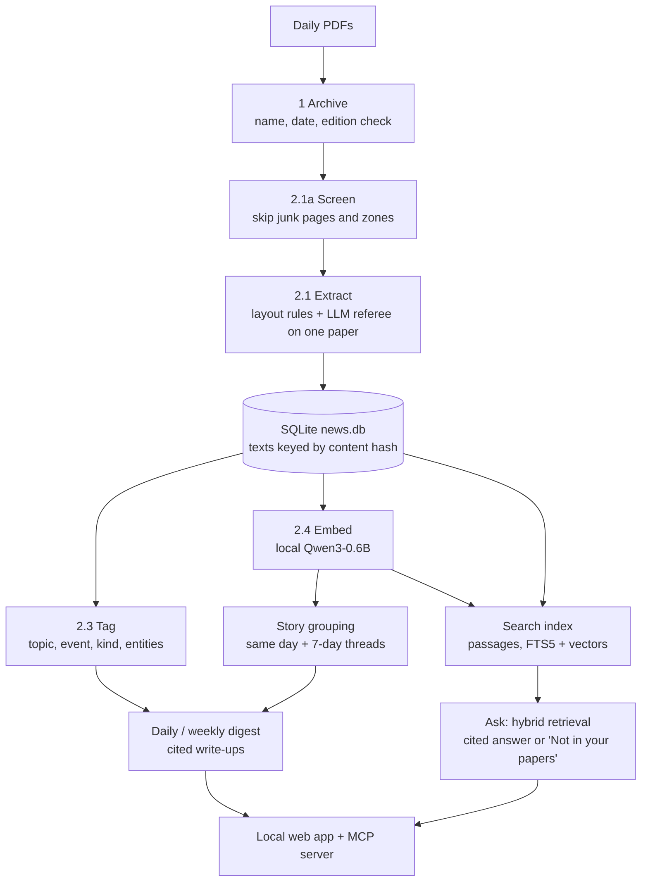

# News Intelligence

A personal pipeline that turns the daily PDF editions of five Indian English newspapers into a searchable archive. Each morning it produces a ranked digest with cited write-ups and answers questions with sentence-level citations back to the PDF page. It runs on one Mac; the only paid parts are Anthropic API calls.

Author: Kunaal Gautam · Started August 2026 · V1 closed 5 Nov 2026 · personal project, in daily use. Status words: **BUILT** = runs daily on real papers · **PARTIAL** = built, with a named part missing or interim · **PLANNED** = not built.

## The problem

A newspaper PDF is a page layout, not a list of articles. Columns, jumps to other pages, ads, puzzles and market tables sit together. Before anything can be asked of a month of papers ("what did each paper say about the EPFO wage ceiling?"), every page has to be split into clean articles. Those articles then need labels, story grouping and an index that can say "this is not in your papers" instead of guessing. The project builds and measures each of those steps.

## Architecture



All of it runs from one command (`src/p3_daily.py`) with one approval at the start.

| Stage | What it does | Model / tool | Status |
|---|---|---|---|
| 1 Archive | Files each PDF as `archive/<date>/<date>_<Publisher>.pdf`; date needs 2 of 3 votes (page text, model, filename) | `claude-haiku-4-5-20251001`, ≈ 1 call per PDF | BUILT |
| 2.1a Screen | Skips or blanks puzzles, notices, tables, box-heavy pages before splitting | PyMuPDF rules | BUILT |
| 2.1 Extract | Splits pages into articles, joins jumps; per-paper settings chosen by A/B test | PyMuPDF layout rules; LLM referee (`claude-haiku-4-5-20251001`, forced tool, fail-closed) on Business Line only | BUILT, frozen at tag `exam-v1` |
| Store | `news.db`: one row per distinct text (SHA-1 of headline + body), placements per extraction run; import refused unless extraction code = `exam-v1` | SQLite | BUILT |
| 2.3 Tag | Topic (75), event (13), kind, forum, entities (8 types), summary | `claude-haiku-5-5`, strict tool use, Batch API | BUILT |
| 2.4 Embed | One vector per article (headline + deck + about the first 400 words) | `Qwen3-Embedding-0.6B` (revision `97b0c61`), local on Apple-silicon GPU | BUILT |
| Story grouping | Same-day groups by cosine bands (0.810 / 0.496); cross-day threads by average linkage ≥ 0.810 over 7 days | numpy | PARTIAL: interim rule, no LLM judge yet |
| Search index | ~250-word passages (50 overlap) → FTS5 + passage vectors | SQLite FTS5, Qwen3 | BUILT |
| Ask | FTS5 top 50 + vector top 50 → reciprocal rank fusion (k = 60) → top 8 passages → answer with per-sentence citations, checked in code | `claude-haiku-5-5` (forced tool); "Think harder" on `claude-sonnet-5-5` (structured output) | BUILT |
| Digest | Ranks stories by placement and size, writes 3–5 cited sentences per story with citation and number checks | `claude-haiku-5-5` | BUILT |
| App | Local FastAPI server + one HTML/JS page: digest, story timelines, Explore, ask pane, pin boards | FastAPI, uvicorn | BUILT (boards: minimum) |
| MCP server | The archive as 10 tools for the Claude desktop app | `mcp` 2.3.0 | BUILT |

## Evals

Pass lines are written before results. A failed line gets error analysis, not a new line. Human labels are blind (labelled without seeing any model output). An LLM labeller counts only after reaching κ ≥ 0.70 against the human labels.

### Extraction: held-out test

61 pages were hand-labelled at text-block level: 39 practice pages for tuning and 22 held-out pages, sealed until the code was frozen (tag `exam-v1`) and run **once** on 18 Oct 2026. Answer keys are in `eval/`. Metrics are word-weighted: coverage, pairwise precision (low = stories merged), pairwise recall (low = stories split). Pass line: 90 on each.

| Paper | Coverage | Precision | Recall | Result |
|---|---|---|---|---|
| Business Line | 97.4 | 97.6 | 95.1 | pass |
| The Hindu | 99.2 | 97.3 | 97.6 | pass |
| Business Standard | 97.3 | 96.0 | 92.0 | pass |
| Times of India | 98.2 | 82.5 | 88.0 | fail: multi-story feature packages merged |
| Mint | 96.3 | 92.2 | 80.1 | fail: long features split at subheadings |
| **All papers** | **97.7** | **89.4** | **89.3** | stories intact 124 / 155 |

Practice pages (39), rules alone → full pipeline: coverage 97.0 → 97.6, precision 95.3 → 96.4, recall 89.6 → 90.5. Screening cut fake articles on 7 junk practice pages from 19 to 3. The two failing papers are recorded as known limits and were not re-tuned on the held-out pages.

**A/B decisions** (rule: weighted score up ≥ 0.5 and no metric down > 1):
- **Referee kept only where it helped.** On for Business Line. Off for Times of India (worse on practice pages) and for Mint (4 pages better, 4 worse).
- **"Whole-block text"** kept for four papers, off for Mint (hurt its precision).
- **A subheading rule was rejected:** precision 95.4 → 87.9.

### Tagging

Blind check of prompt v1.3 on **20 articles** labelled by the author (22–23 Oct), scored as label sets:

| Measure | Result | Pre-set line |
|---|---|---|
| Topic set recall | 73% | 85 |
| Topic set precision | 58% | 70 |
| Main topic match | 75% | 70–75 acceptable |
| Event set recall | 80% | 80 |
| Kind | 60% | 85 |

The pre-registered rule allowed at most one prompt fix and then the full run, so these stand as known limits. An earlier 60-article audit of prompt v1, where the reviewer saw the model's label first, scored 88–90% on topic. A blind check on 20 articles scored 60%. That gap is why blind labels are the reference.

### Embedding model choice

A blind pair test was pre-registered on 24 Oct. Pairs of articles from different papers were drawn by seeded routes and labelled by the author (same event / follow-up / same subject / unrelated). Main metric: AUC for "same event" vs "same subject". **Qwen3-Embedding-0.6B scored 93.0** and beat MiniLM and BGE-M3 with bootstrap ranges clear of zero. voyage-4 (API) was run afterwards and was not better (−1.8, range −4.6 to +0.5). A longer input did not help on 122 long-article pairs (−0.5, range −3.3 to +2.5). Opus as a second labeller on 127 pairs reached 87.4% raw agreement but κ 0.49, so it is not used as an answer key.

### Retrieval and answers

- **Retrieval set:** 20 questions dictated by the author + 3 questions verified absent from the archive, 76 answer articles, frozen before scoring (ship rule: recall@5 ≥ 70%). **recall@5: hybrid 100%, word-only 95%, vector-only 95%** (recall@10: 100% for all). Nothing was tuned on it. The "Not in your papers" threshold (top-passage cosine 0.5663) is the midpoint of the gap on this same set (answerable 0.6174–0.8915, absent 0.4523–0.5151), so it is fitted, not held out.
- **Follow-up rewriter:** a frozen set of 10 follow-ups and 11 topic switches. Follow-ups kept their topic **10/10**. Switches were detected **8/11** against a line of 9; this miss was accepted for V1 and the three misses are on the V2 list.
- **Answers:** every sentence must cite an article in the retrieved passages, and every number must appear in the cited article; failing sentences are dropped. There is **no graded answer-quality eval yet**.
- **Stories:** a blind check of the cross-day rule failed both pre-set lines. Of the links it made, 14/20 were right (line ≥ 18). Of the candidates it rejected, 16/20 belonged together, and 8 or more already counted as too strict. Error analysis: half the misses were not news (classifieds, notices; now excluded), half were "same subject vs same story" on long processes. Hence the planned LLM judge rather than a new threshold.

### Known limits

- Times of India precision and Mint recall are below 90 on held-out pages.
- Indian Express and Financial Express can't be read (broken font encoding); PDFs with no text layer are skipped; charts are not read.
- Tag v1.3 kind accuracy is 60% on a 20-article blind check; entities are not resolved (one entity can appear under two names).
- Story groups are one-day groups; cross-day links are untyped until a judge passes.
- The `thin` threshold (0.6150) and the related-story bar (0.65) are placed, not measured.
- Page links say "PDF page N", because the printed-to-PDF page offset is not stored.

## Results and scale

As of 9 Nov 2026 (read-only counts):

| | |
|---|---|
| Papers | 5 (The Hindu, Business Line, Mint, Times of India, Business Standard) |
| Dates | 16 Sep – 4 Nov 2026: 34 dates, 83 paper-days |
| PDFs | 96 archived, 2,128 pages |
| Articles | 8,838 distinct texts (2.70 M words), all tagged on prompt v1.3 |
| Entities | 56,256 mentions; 24,764 distinct names (unresolved); 1,406 named in ≥ 3 papers |
| Search | 14,340 passages |
| Stories | 7,964 day-groups, 639 with ≥ 2 articles; 389 cross-day thread links |
| Storage | news.db 56 MB · vectors.db 256 MB · search.db 112 MB · intel.db 15 MB |

## Cost

Measured from the call logs:

| | |
|---|---|
| Tagging, all runs and tests (19 Oct – 5 Nov) | $8.29 total; **$0.00056 per article** on the Batch API (5,731 articles for $3.18) |
| Extraction referee (Business Line) | $2.98 over 311 pages = **$0.0096 per page** |
| Digests, questions, write-ups (1–6 Nov) | $0.20 total; a Haiku answer ≈ $0.0006, a Sonnet "Think harder" ≈ $0.020, a day digest $0.0054–0.0059 |
| Catch-up morning run (9 days, 18 paper files, 2,089 new articles) | ≈ $2.05, 63 minutes |
| One-paper morning run (5 Nov) | 8 minutes |
| **Estimate:** monthly running cost | **≈ $7 a month** for the morning run (the 9-day catch-up run scaled to 30 days; excludes archive calls and questions; not a measured month) |

Embeddings are local ($0). The daily spending cap in the app is $1.00. Phase 1 archive calls are not cost-logged.

## Design decisions

1. **Content hashes so re-runs never pay twice.** Texts are keyed by SHA-1 of headline + body; tags by text × model × prompt version; referee answers and digest write-ups are cached by content. A re-run skips finished work.
2. **Rules first, LLM only where rules measurably fail.** Layout rules run on every page; the referee runs on the one paper where an A/B test showed it helps.
3. **Local embeddings over an API.** The local model was chosen by a pre-registered blind test that the API model did not win. It costs $0 per run, and article text stays on the machine.
4. **"Not in your papers" from the cosine, not the fused score.** Reciprocal rank fusion encodes rank, not match strength; the fused ranges for answerable and absent questions overlapped. An empty result makes no model call.

## How to run it

Requires macOS on Apple silicon and Python 3.14, with two environments: `.venv` for the pipeline and app, and `.venv-embed` for the embedding model.

```bash
python3.14 -m venv .venv && .venv/bin/pip install -r requirements.txt
.venv/bin/pip install mcp==2.3.0          # MCP server only; not yet in requirements.txt
python3.14 -m venv .venv-embed && .venv-embed/bin/pip install -r requirements-embed.txt
```

**Environment variables** (read from `~/.config/news-intel/.env`, outside the project): `ANTHROPIC_API_KEY` (required for paid steps); `VOYAGE_API_KEY` (only for the optional voyage-4 baseline). Optional: `NI_APP_PORT` (default 8765), `NI_EMBED_PORT` (default 8766).

**Commands** (from the repo root):

```bash
.venv/bin/python src/p3_daily.py --dry-run     # prints the plan and estimate, spends nothing
.venv/bin/python src/p3_daily.py               # the morning run: one approval, then archive → … → digest
launch/start.sh                                # starts the embedding service and the app, opens http://127.0.0.1:8765
.venv/bin/python src/p3_search.py "EPFO wage ceiling"          # search only, free
.venv/bin/python src/p3_search.py "why did employers welcome it?" --ask   # cited answer (paid, ≈ $0.0008)
.venv/bin/python src/p2_check.py --root . --papers archive --pipeline     # extraction scores, practice pages only
```

**Expected output:** `p3_daily.py` lists the steps with a cost estimate and asks once. It then prints one line per step, stops at the first failure naming the step, and ends with one summary line. The day digest lands in `data/digests/<date>_day.json` with a health line.

**Tests** are standalone scripts (no pytest), e.g. `.venv/bin/python tests/test_p3_search.py`. No test calls the API: a fake model client is always used, and a wrapper refuses any connection off this machine. The app suite passed 1207/1207 at V1.

**Not in this repository:** newspaper PDFs, extracted article text and databases (publishers' copyright; the scripts run on your own copies), hand-made labels, and the API key. A fresh-clone setup has not been tested end to end: the code expects the archive and data folders this pipeline builds.

## Roadmap

- **Story judges:** an LLM same-day judge (200-pair blind test drawn, not yet labelled) and a cross-day judge (100-pair test). Each is gated on κ ≥ 0.70 against blind labels, run in shadow mode, then switched on.
- **Wire-copy measurement** (the same agency story printed in several papers) before ranking weights go live; a blind ranking-weight test on judged groups.
- **Search:** a near-miss question set to measure the `thin` threshold; rewriter tuning on a new blind set; a judged related-story set; a graded answer-quality eval.
- **Pipeline:** scheduled morning runs, chart reading (vision), OCR for image-only PDFs, entity resolution, extraction fixes for Times of India and Mint tested on fresh held-out pages.
- **App:** fixes from the first week of use; full boards.
